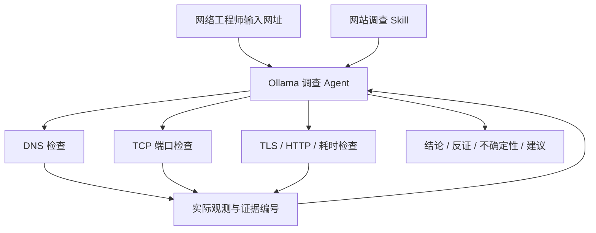

# 网站访问异常诊断 Agent

面向校园网工程师：输入一个网址，Agent 调用 DNS、TCP、HTTP/TLS 工具，
定位访问异常的阶段，展示证据、反证、不确定性以及后续检查建议。

这是独立工程，不依赖上一级汽车实验或老师的示例代码。
默认由本地 Ollama 模型选择工具；`rules` 是明确标注的确定性工具测试模式。

## 0. 推荐：使用网页工作台

进入仓库根目录（包含 `run.py`），双击 `start-web.cmd`，或在 PowerShell 执行：

```powershell
python -B run.py web --open
```

在浏览器访问 **http://127.0.0.1:8765**，保持启动程序的终端窗口打开。按 `Ctrl+C` 关闭服务。
如端口被占用，可改为 `python -B run.py web --port 8766 --open` 并访问对应地址。

网页已包含构建好的 React 前端；日常运行只需要 Python 3.10+，无须安装 Node.js 或第三方 Python 依赖。

| 页面 | 可用操作 |
|---|---|
| 网站诊断 | 输入网址、选择模型/引擎/调查方式、设置超时和慢阈值、查看真实检测进度与报告 |
| 故障实验室 | 运行七类受控案例，清楚区分本机实测、模拟夹具与规则工具测试 |
| 对照评测 | 选择案例、实验组、模型与重复次数；运行 A/B/C 或规则测试；查看已有实验和下载 CSV |
| 报告档案 | 搜索、筛选和分页查看现有报告；查看证据、模型草稿和校验记录；下载 Markdown/JSON |
| 运行设置 | 检查本机 Ollama 连接与可用模型，保存浏览器默认配置，查看实际输出位置 |

第一次可在“故障实验室”选择“HTTP 错误响应”，把运行引擎切换为“规则工具测试”，再点击“运行实验”。
有可用 Ollama 模型后再使用大模型调查；未连接或模型失败会显示真实失败，不伪造结果。
“停止后续步骤”会等待当前网络或模型调用结束再停止，已有观测保留在任务记录中。

新网页任务和报告保存在 `results/web/<任务编号>/`；旧报告不改写。服务重启后保留历史结果，
上次未完成的任务标记为中断。设置仅保存在当前浏览器中，修改默认配置不影响已启动任务。

服务只监听本机 `127.0.0.1`，不可供其他电脑直接访问。下载与读取只允许结果目录中的报告，
不提供任意命令执行或网络配置修改功能。

前端开发源码在 `frontend/src/`，视觉和功能规范见 `docs/frontend-design.md`。需要修改界面时，在安装
Node.js 的开发环境中进入 `frontend/`，执行 `npm install` 和 `npm run build`；运行时使用 `frontend/dist/`。
`npm run dev` 可供开发预览，API 代理到本机 8765 端口；日常使用仍建议运行 Python 提供的同源完整工作台。

## 1. 环境与最快运行

- Python 3.10+。Python 程序只使用标准库，无须 pip 安装依赖。
- Ollama 服务，已下载支持工具调用的模型。当前工程按 `qwen3.5:0.8b` 配置。
- 终端进入本工程目录；以下为 PowerShell 命令。

```powershell
python run.py doctor
python run.py demo --case http_error
```

最后一个命令会自动启动一个只监听 `127.0.0.1` 的临时 HTTP 503 服务，
让真实模型调用真实网络探测，再保存报告并关闭服务。无需等待真实网站出故障。

如果本机还没启动 Ollama，在另一个终端启动服务；需要时下载模型：

```powershell
ollama serve
ollama pull qwen3.5:0.8b
```

切换已有模型：

```powershell
python run.py demo --case http_error --model qwen3:4b
```

也可通过 `OLLAMA_MODEL`、`OLLAMA_HOST` 配置；`.env.example` 是说明模板，程序不会自动读取 `.env`。

## 2. 检查实际网址

```powershell
python run.py diagnose https://example.org
python run.py diagnose https://example.org --timeout 3 --slow-ms 800
```

输出内容：各阶段状态和数据来源、诊断结论、处理与复测建议、模型调用次数、JSON 和 Markdown 报告路径。
实测事实、确定性程序的阶段建议、模型补充意见分别展示。小模型可能给出不可靠的自由文本解释或建议，
因此程序建议不计入 LLM 成绩，模型补充标为待核对；模型失败也保留独立工具事实，不伪造成功。
JSON 保存实际工具调用、模型消息、token 计数和本次实际加载的 Skill 文本。
输出默认位于 `results/`，每次诊断使用独立文件名。

工具是从运行机器进行的直连探测，不使用环境代理，不代表整个校园网所有用户的体验。
探测请求只检查响应头，不读取网页正文，不验证页面渲染、登录或业务功能。
HTTP 重定向不自动跟踪，应报告后续访问链尚待确认。

## 3. 没有模型也能验证工具

```powershell
python run.py demo --all --engine rules --out results/rules-demo
```

这会跑完七个案例，明确显示“规则引擎，不是大模型 Agent 实验成绩”。
模型失败时不会悄悄用规则答案替代。

| 案例 ID | 异常制造方式 | 数据来源 |
|---|---|---|
| normal | 本地服务返回 200 | 真实本机网络探测 |
| dns_failure | 返回模拟 NXDOMAIN 记录 | 明确标记的模拟夹具 |
| tcp_failure | 占用临时端口但不监听 | 真实本机网络探测 |
| tls_failure | 用 HTTPS 连接只支持 HTTP 的本地服务 | 真实本机 TLS 失败 |
| http_error | 本地服务返回 503 | 真实本机网络探测 |
| slow_response | 返回响应头前等待 1.2 秒 | 真实本机网络探测 |
| insufficient_evidence | DNS/TCP 正常但缺少 HTTP 观测 | 明确标记的模拟夹具 |

默认慢响应阈值为 800 ms，是可配置的实验阈值，不是行业通用 SLA。
实验服务仅在命令执行期间启动，结束后自动关闭；不修改 DNS、代理、防火墙或网络配置。

## 4. Agent、Tool 与 Skill



| Tool | 输入 | 输出 | 主要边界 |
|---|---|---|---|
| check_dns | 初始化时绑定的目标域名 | 地址或解析错误、耗时 | IP 地址输入不测试 DNS 服务；DNS 查询有等待上限 |
| check_tcp | 同一目标地址和端口 | 连接结果、耗时、失败记录 | 不从拒绝/超时单独推断防火墙根因；最多尝试前三个地址 |
| check_http | 同一目标、已成功连接的地址 | TLS 结果、HTTP 状态、响应等待耗时 | 使用证书校验；不读正文；不追踪重定向 |

三个工具的调用参数为空对象，目标已绑定，模型不能自行切换到其他目标或执行命令。
非对象参数（包括 `null`、`false`、`0` 和 `[]`）以及非空对象会被拒绝。
实时探测与评测回放共用前置条件：DNS 成功后才能调用 TCP，DNS/TCP 均成功后才能调用 HTTP。
乱序调用或前置检查未成功的调用不执行工具、不生成证据，工具调用正确率会计入这次无效尝试。
专业 Skill 位于 `skills/website-investigation/SKILL.md`，C 组会实际读取并加入系统提示。
B 组不加载该文件。它规定证据顺序、反证方法、阶段判断和常见误判。

程序在测量前根据网址列出候选假设，包含 TCP 不可达、HTTP 错误、慢响应和基础访问正常。域名目标增加 DNS 假设，HTTPS 目标增加 TLS 假设。候选是假设模板，JSON 和 Markdown 均保存本次实际使用的列表。
工具结果有 `live_probe` / `synthetic_fixture` 数据来源以及时间记录。
系统对各实验组共用结构、证据编号和诊断阶段一致性校验。
例如 HTTP 503 且 slow=false 时，不接受“响应过慢”的分类，会反馈冲突并要求模型自行修正。
校验不读取案例正确标签，不用规则答案替模型改写结论；不能修正则记录执行失败。
一次校验失败后，普通类别修正阶段的 JSON 候选限定为与实际观测相容的类别（允许证据不足），
并要求引用决定性阶段的真实证据。这是各组共用的确定性护栏，不属于 LLM 自发能力。
所有首次及被拒绝的结构化草稿保留在 JSON，避免把校验后的成绩当作模型未经帮助的能力。
结构和阶段一致不等于解释、因果判断或建议完全正确，仍需人工审阅。

为避免“类别正常、摘要却说响应偏慢”的矛盾，最终 `summary` 采用与类别绑定的程序短句，
由模型选择类别后逐字校验；不能把摘要文字当作模型自由解释能力的成绩。
模型其他文字不得重复耗时数值或进行数值比较；具体数值及阈值关系由程序展示。
有限规则另外拦截已知的慢响应断言冲突、未验证阶段的错误排除，以及无依据的证书修复、
增大超时、重启或重新部署建议。文字校验失败后，修正阶段会提供基于观测的文字候选，
由模型重新选择。此阶段已有明确观测时，阶段候选不再允许改为证据不足；没有明确阶段时仍为证据不足。
JSON 和报告明确标记这种程序辅助；评测另计 `narrative_repair_used` 和 `narrative_repair_runs`，
不能把该结果计作模型未经帮助的分类或解释能力。持续失败记录为执行失败，
不会用程序结论伪造模型成功。被拒绝的草稿留在 JSON；终端及 Markdown 判断区只展示通过校验的结果。
这些规则不能理解所有自然语言表达，也不保证自由文本完全正确。上述改动改变了提示和输出约束，
新的评测需与旧版实验分开说明。

## 5. 三组公平对照实验

```powershell
python run.py evaluate --out results/abc-run-1
```

本仓库保存的正式实验使用 `qwen3.5:0.8b`，记录位于
`results/course-abc-qwen35-20261116/`。使用相同模型重新评测：

```powershell
python run.py evaluate --model qwen3.5:0.8b --out results/course-abc-rerun
```

模型需事先在本机可用。历史结果保留原样；代码和 Skill 更新后，需重新评测才能衡量改进，
旧实验清单中的源码哈希标识旧版本，不应改写为当前版本的哈希。

完整运行需要多次本地模型请求；终端会逐项显示进度。

- A / baseline：同一模型直接分析原始观测，不提供工具，不加载 Skill。
- B / tools：同一模型通过工具查询原始观测，不加载 Skill。
- C / skill：同一模型通过工具查询，并加载专业 Skill。

先在本地故障环境采集一次观测，再对三组回放相同数据，避免时刻或故障状态不同。
A 在提示中看到全部相同原始观测；B/C 从工具取得这些数据。
工具回放不会伪称再次进行了实时探测；JSON 中注明评测采用回放。
A/B/C 收到相同的报障描述和候选假设。HTTP 503 案例加入“有同事猜测是链路拥塞”的待核实线索。
`data/cases.json` 记录每个案例的描述、决定性工具和验收依据。除报障描述外，案例 ID、故障注入方式、验收依据和正确标签均不传入模型上下文。
`evaluation.csv` 的 Trace 路径相对于本次评测目录，整个目录复制后仍能对应每次运行。

先小范围运行：

```powershell
python run.py evaluate --cases normal http_error --modes baseline tools skill --out results/abc-small
```

重复实验：

```powershell
python run.py evaluate --repeats 3 --out results/abc-repeat-3
```

种子和温度固定，重复运行主要检查运行稳定性，不应把它解释为独立抽样的模型方差。
评测会保存 `evaluation.csv`、`summary.json`、`evaluation.md`、原始观测和每次完整 Trace。
切换输出目录可保留不同配置实验。模型执行失败会计入失败，不编造成成功。

Windows 上可根据实际完成的评测生成对比图（系统自带 .NET Charting，无额外 Python 库）：

```powershell
powershell -ExecutionPolicy Bypass -File plot_evaluation.ps1 -ResultsDirectory results/abc-run-1
```

生成 `comparison.png`，分别展示首次草稿、校验后的最终准确率和任务成功率；不混淆三者。

指标定义：

- 结论正确率：匹配预设诊断类别的运行数 / 全部运行数，含执行失败。
- 首次草稿正确率：首次可解析结构化草稿的类别正确运行数 / 全部运行数；没有有效草稿按失败计。
- 任务成功率：类别正确、引用决定性阶段证据，且有后续建议。
- 证据覆盖率：引用的必要阶段工具数 / 案例必要阶段工具数。
- 工具调用正确率：工具名、参数和前置条件有效的调用数 / 总调用数；A 组不适用。
- 正常误报率：正常案例被明确判断异常的次数 / 正常案例次数；执行失败另计。
- 平均运行时间、模型请求和 token 数也保存供比较。

自动评分不能全面判断解释和建议质量，至少人工分析一个失败或不理想案例。
小案例集上的高分不证明真实网络泛化，也不保证 Skill 必然改善成绩。
不使用模型的评测仅用于检查工具链：

```powershell
python run.py evaluate --engine rules --out results/rules-evaluation
```

## 5.1 本次课程提交的运行记录

- 正式 A/B/C 评测使用 qwen3.5:0.8b，每组 7 个案例。逐次结果、实际观测、环境配置和 Trace 在 `results/course-abc-qwen35-20261116/`。
- 网页 HTTP 503 演示使用同一模型的 Skill 模式。对应的实测 JSON 和 Markdown 在 `results/course-web-20261116/`，报告图 4、图 5 的原始截图区域在 `docs/screenshots/`。
- 课程报告单独提交，不随 GitHub 仓库上传。设计与开发过程见 `docs/`，正式结果与逐次记录见上述实验目录。

## 6. 测试

```powershell
python -m unittest discover -s tests -v
```

测试无需联网或启动模型；包括真实本地故障、前置失败停止、目标绑定、证据编号校验、
工具循环收尾、Skill 加载、无工具组的信息范围和模型失败如实记录。
回归测试还覆盖显式端口 `0` 拒绝、非对象参数、实时/回放前置条件一致性、
前置失败或观测缺失时阻止后续调用，以及乱序调用纠正后的评测计数。

## 7. 目录

以下为 GitHub 上传版本的主要目录；构建资源和逐次实验记录不逐一展开。

```text
website-diagnosis-agent/
├── run.py                         # 命令行及网页启动入口
├── start-web.cmd                  # Windows 网页启动脚本
├── README.md                      # 项目与运行说明
├── requirements.txt               # Python 部分无第三方依赖
├── .env.example                   # 环境变量配置示例
├── .gitignore                     # 排除缓存、依赖和新运行产物
├── plot_evaluation.ps1            # 根据评测数据绘制对比图
├── src/
│   ├── __init__.py
│   ├── agent.py                   # 本地模型适配、实际工具循环、规则测试引擎
│   ├── tools.py                   # DNS / TCP / TLS / HTTP 探测
│   ├── lab.py                     # 临时故障服务与模拟夹具
│   ├── evaluation.py              # 独立评分和公平 A/B/C
│   ├── report.py                  # 终端、Markdown、JSON 记录
│   ├── validation.py              # 摘要模板和已知文字矛盾校验
│   └── web.py                     # 本机网页服务、任务和 API
├── frontend/
│   ├── src/                      # React 页面、样式与交互源码
│   ├── dist/                     # 已构建页面，供 Python 直接提供服务
│   ├── index.html
│   ├── package.json
│   ├── package-lock.json
│   └── vite.config.js
├── docs/
│   ├── project-introduction.md   # 早期项目介绍与答辩讨论稿
│   ├── frontend-design.md        # 前端界面设计文档
│   ├── development-notes.md      # 开发问题、修正及测试记录
│   └── screenshots/              # 真实网页运行截图
├── skills/website-investigation/SKILL.md
├── data/cases.json                # 正确标签仅供评测，不输入模型
├── tests/
│   ├── test_agent.py              # 工具、Agent 与评测测试
│   ├── test_narrative.py          # 文字矛盾与修正回归测试
│   └── test_web.py                # 网页接口与任务测试
└── results/
    ├── course-abc-qwen35-20261116/ # 正式 A/B/C 评测、观测及 Trace
    └── course-web-20261116/       # 真实网页 HTTP 503 演示记录
```

`frontend/node_modules/`、`work/` 和 Python 缓存不随仓库上传。`docs/` 中的早期讨论稿
反映当时的设计和旧实验，不代替本次正式实验记录；当前成绩以 `results/course-abc-qwen35-20261116/` 为准。

## 8. 当前范围与后续工作

这是可运行的最小工程，用于从本机观察访问异常的阶段。
它不读取校园交换机拓扑、路由表或防火墙后台，因此不能精确定位某台网络设备的根因。
响应等待时间包含网络和服务处理；不能仅凭等待偏长认定拥塞。
当前提供本机网页工作台和命令行界面；网页、终端和 Markdown 报告可用于真实运行截图。
课程最终报告中的截图、结论和表格应来自实际运行，避免把规则测试结果当作 LLM 成绩。

代码由 AI 辅助生成，提交前应逐项理解工具实现、数据来源、Skill 和评分口径，并记录自己的检查与修改。
